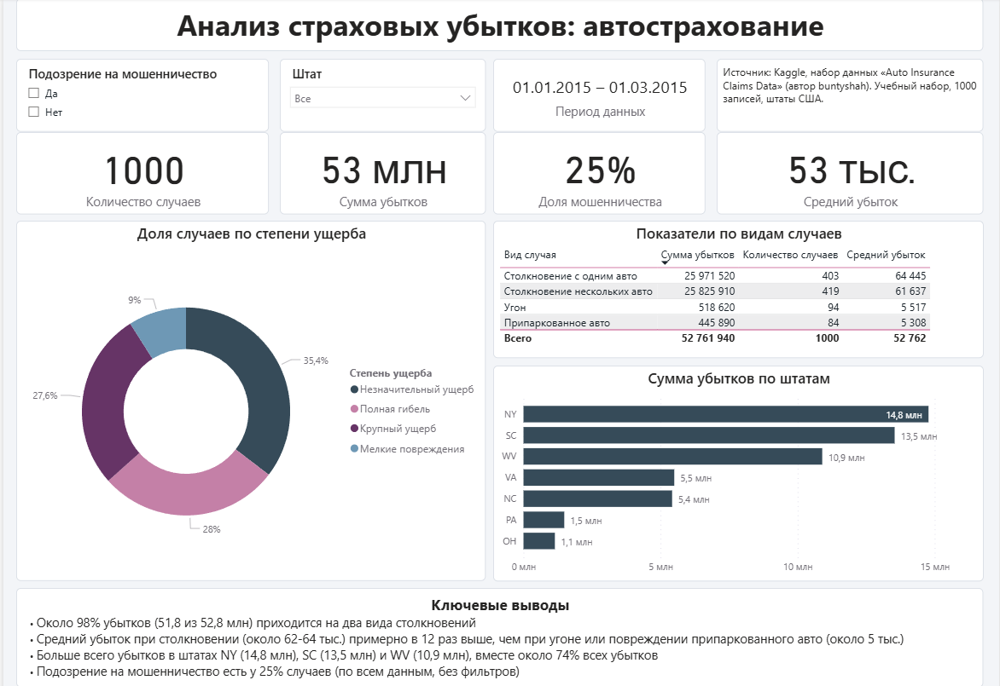

# Анализ страховых убытков: автострахование

Учебный интерактивный дашборд в Power BI Desktop.

## Данные
Kaggle, набор «Auto Insurance Claims Data» (автор buntyshah): 1000 записей, период 01.01.2015 – 01.03.2015, штаты США. Учебный набор данных.

## Что внутри
- Показатели: количество случаев, сумма и средний убыток, доля случаев с подозрением на мошенничество
- Таблица показателей по видам случаев
- Структура случаев по степени ущерба
- Сумма убытков по штатам
- Фильтры по штату и признаку мошенничества
- Период данных и ключевые выводы

## Инструменты
Power BI Desktop, Power Query (подготовка данных, перевод значений на русский), DAX (меры).

## Основные выводы
- Около 98% убытков приходится на два вида столкновений.
- Средний убыток при столкновении примерно в 12 раз выше, чем при угоне и повреждении припаркованного авто.
- Больше всего убытков в штатах NY, SC и WV (около 74%).
- Подозрение на мошенничество есть у 25% случаев.

## Файлы
- `insurance-claims.pbix` — файл отчёта Power BI
- `insurance-claims.pdf` — версия для просмотра
- `dashboard.png` — скриншот дашборда
